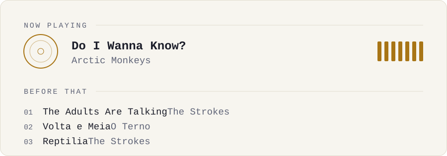

# Earworm

A live "now playing" card for your GitHub profile. It shows what you're listening to on Spotify right now and the songs before it. It runs on your own Cloudflare Worker, on the free plan.

<picture>
  <source media="(prefers-color-scheme: dark)" srcset="previews/earworm-dark.svg">
  
</picture>

## What you get

- The song playing right now. When nothing is playing, you get the last one you played.
- The songs before it, up to five, with repeats skipped.
- Light and dark versions that follow the visitor's GitHub theme.
- A spinning record and an equalizer that only move while music is playing. Visitors who prefer reduced motion get a still card.
- Optional album art and accent colour.
- No broken image if Spotify is down: the card falls back to a quiet "nothing playing" state.

## Setup (about 5 minutes)

You need Node.js 18+ and a free Cloudflare account. Spotify only lets each app read its owner's listening, so everyone runs their own copy.

**1. Create a Spotify app.** Go to [developer.spotify.com/dashboard](https://developer.spotify.com/dashboard), create an app, and add this Redirect URI:

```
http://127.0.0.1:8888/callback
```

Keep the Client ID and Client Secret at hand.

**2. Get the code and log in to Cloudflare.**

```bash
git clone https://github.com/mxxnpy/earworm
cd earworm
npm install
npx wrangler login
```

**3. Deploy the Worker.** The first deploy asks you to pick a `workers.dev` subdomain. Write down the URL it prints.

```bash
npm run deploy
```

**4. Connect Spotify.** This opens Spotify in your browser. Once you allow access, it saves the three secrets straight into the Worker. Nothing is printed or written to disk.

```bash
npm run auth
```

## Add it to your profile

Paste this in your profile README and replace the URL with yours:

```html
<picture>
  <source media="(prefers-color-scheme: dark)" srcset="https://earworm.YOUR-SUBDOMAIN.workers.dev/?theme=dark">
  
</picture>
```

## Options

Add these to the URL:

| Option | Values | Default |
| --- | --- | --- |
| `theme` | `dark`, `light` | `dark` |
| `recent` | `0` to `5` | `3` |
| `accent` | a hex colour without `#`, like `1db954` | gold in dark, bronze in light |
| `cover` | `1` to show the album art instead of the record | off |

Example: `?theme=dark&recent=5&accent=1db954&cover=1`

## How it works

GitHub fetches the image through its own proxy every time someone opens your profile. The Worker answers with `no-cache`, so the card stays current. It also keeps a 15-second cache at Cloudflare's edge, so a busy profile doesn't hit the Spotify API on every view. Album art is embedded in the SVG, because GitHub blocks external images inside SVGs.

The Worker only asks Spotify for two things: `user-read-currently-playing` and `user-read-recently-played`.

## Change the look

The card is drawn in [`src/render.js`](src/render.js). After editing it, run `npm run previews` to regenerate the example images, then `npm run deploy`.

## License

MIT. Made by [Ayu](https://github.com/mxxnpy).
